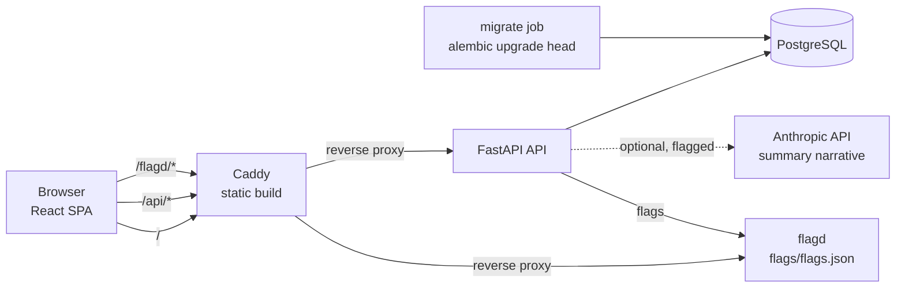

# Patient Registry

A patient management dashboard for a medical practice. Staff can browse, search and filter patients, keep clinical notes, read a generated patient summary, and create or edit patients with full validation.

**Stack:** FastAPI · PostgreSQL 18 · SQLAlchemy 2 (async) · Alembic · React 19 (TypeScript, React Compiler) · TanStack Router and Query · React Aria Components · Docker Compose.

> All patient data in this repository is **synthetic**, generated with Faker from a fixed seed. Emails use `example.com`, and phone numbers are in the fictional 555-01xx range.

## Quick start

You need Docker with Compose v2. No `.env` file or API key is required.

```bash
docker compose up --build --wait     # or: make up
```

| What | URL |
|---|---|
| Web app | http://localhost:8080 |
| API (OpenAPI docs) | http://localhost:8000/docs |
| API through the web proxy | http://localhost:8080/api/health |

The database is migrated by a one-off `migrate` service and seeded with 20 synthetic patients on first start. To see the list at scale, run `docker compose down -v && SEED_PATIENTS=1000 docker compose up --wait`. Hot reload for both apps: `make watch`. Every variable is documented in [`.env.example`](.env.example).

## Running without Docker

You need Python 3.14 with [uv](https://docs.astral.sh/uv/), Node 24 with pnpm, and PostgreSQL 16 or later.

```bash
make install                                   # uv sync + pnpm install (also installs git hooks)
createdb registry                              # or point DATABASE_URL at any Postgres
export DATABASE_URL=postgresql+asyncpg://$USER@localhost:5432/registry
cd apps/api && uv run alembic upgrade head && uv run uvicorn app.main:app --reload   # :8000
cd apps/web && pnpm dev                        # :5173, proxies /api to :8000
```

Without flagd, feature flags fall back to their defaults (AI features off).

## Architecture



- **API** (`apps/api`):
  - Layers: routers (HTTP) → services (no HTTP knowledge) → SQLAlchemy models.
  - Pydantic v2 validates every input. Errors are [RFC 9457](https://www.rfc-editor.org/rfc/rfc9457) `application/problem+json`, with field-level details on `422`.
  - Logs are structured JSON with a request ID, and never include bodies, query strings or patient fields.
- **Web** (`apps/web`):
  - Server state lives in TanStack Query, and list state (search, filter, sort, page) in the URL through typed TanStack Router search params, with no global client store.
  - The typed API client and Zod schemas are **generated from the OpenAPI schema** with Orval, and CI fails if they drift.
  - The UI is React Aria Components with CSS Modules and design tokens. Light and dark follow the system setting.
  - Search never blocks typing: a 250ms debounce plus `useDeferredValue`, with stale requests aborted.
  - Routes are lazy-loaded.
- **Feature flags:** OpenFeature on both ends, with [flagd](https://flagd.dev) reading the committed [`flags/flags.json`](flags/flags.json). Moving to LaunchDarkly, GrowthBook or Unleash only means swapping the provider registration in `apps/api/src/app/flags.py` and `apps/web/src/lib/flags.ts`.

Decisions are recorded as ADRs in [`docs/decisions/`](docs/decisions/README.md): derived `last_visit`, child tables for allergies and conditions, soft delete, offset pagination, the UI stack, routing, forms, linting, flags, serving, client generation, and in-memory drafts.

## API overview

| Method | Path | Success | Errors |
|---|---|---|---|
| GET | `/health` | `200 {"status":"ok"}` | — |
| GET | `/patients?q=&status=&blood_type=&condition=&allergy=&sort=&limit=&offset=` | `200 {items,total,limit,offset}` | 422 |
| POST | `/patients` | `201` + `Location`, `ETag` | 422 |
| GET | `/patients/{id}` | `200` + `ETag` | 404 |
| PUT | `/patients/{id}` (full replacement, `If-Match` required) | `200` + new `ETag` | 404, 412, 422, 428 |
| DELETE | `/patients/{id}` (soft delete) | `204` | 404, 412 |
| GET / POST | `/patients/{id}/notes` | `200` / `201` + `Location` | 404, 422 |
| GET / DELETE | `/patients/{id}/notes/{note_id}` | `200` / `204` | 404 (also for another patient's note) |
| GET | `/patients/{id}/summary` | `200` | 404 |

- **Search:** `q` matches the full name, email or phone through `pg_trgm` indexes.
- **Sorting:** `sort` comes from an allowlist (`last_name`, `first_name`, `age`, `last_visit`, `created_at`), with `-` for descending.
- **Derived fields:** `age` and `last_visit` are computed, never stored.
- **Concurrency:** two people editing the same patient get a `412` instead of a lost update.
- **Contract:** the full schema is at `/docs`, and committed as [`apps/api/openapi.json`](apps/api/openapi.json).

### Patient summary

Identifiers and clinical facts (name, age, blood type, conditions, allergies) always come straight from the database. Only the narrative is generated.

- **Default:** a deterministic template provider that works offline.
- **Optional:** an Anthropic provider (`claude-haiku-5-5`, set by `ANTHROPIC_MODEL`). To use it, set `ANTHROPIC_API_KEY` and turn on `summary-provider-anthropic` in `flags/flags.json`. It receives note text and timestamps only, never identifiers.
- **Fallback:** any failure or refusal falls back to the template, and the response always says which provider produced the narrative. Results are cached by a hash of the notes.

**Sending patient data to a third-party model would require a business associate agreement (BAA) in production.**

## Testing

| Command | What it runs |
|---|---|
| `make check` | Ruff, pyright (strict), Biome, stylelint (token-only CSS), `tsc` (strict), about 210 API tests against a real Postgres (testcontainers, 98% coverage), Vitest component tests with MSW |
| `make e2e` | Playwright journeys for every main flow, on Chromium and Firefox at 1280 and Chromium at 360: list URL state, optimistic notes with retry, delete confirmation, the create wizard, client and server validation, the `412` conflict, offline save, and 404s. Also runs axe (WCAG 2.2 AA) on every route in light and dark, plus a reduced-motion check. Needs the stack running |
| `make lighthouse` | Lighthouse CI, mobile and desktop, asserting 95 or higher in every category |
| `make eval` | The summary narrative eval (`apps/api/evals/summary/`): 25 synthetic cases with code graders (no invented dates, numbers or drugs, no identifiers, prompt-injection resistance) and an optional Claude judge. Without `ANTHROPIC_API_KEY` it's a free dry run that prints the estimated cost of a paid run (about $0.13) |

CI ([`.github/workflows/ci.yml`](.github/workflows/ci.yml)) runs lint, typecheck, tests and the API-contract drift check, then a Compose smoke test, e2e and axe, and Lighthouse.

## Stretch goals

| Goal | Status |
|---|---|
| **Advanced Backend:** sorting and filtering query params, request-logging middleware, Alembic migrations | ✅ Done |
| **Testing & Quality:** API tests, component tests, e2e tests | ✅ Done |
| Developer Experience: CI pipeline, hot reload in Docker | ✅ Done |
| Performance: code splitting and lazy loading | ✅ Done (lazy routes, lazy-loaded shell extras, entry chunk about 120 kB gzip) |
| Performance: virtualized list | ⏳ Backlog (server-side paging keeps the DOM at 20 rows) |
| Advanced UI/UX: dark/light theme | ✅ Follows the system setting. Manual toggle on the backlog (tokens already support `data-theme`) |
| Advanced UI/UX: advanced search with filters | 🟡 The API supports status, blood type, condition and allergy filters; the UI exposes status |
| Advanced UI/UX: patient status chart | ⏳ Backlog (the dashboard reserves its slot) |

## Designed to grow

- **Auth and roles:** an OIDC provider in front of the API, with a FastAPI dependency that resolves the user and their role (clinician, front desk, manager) and checks it per route. The `If-Match`/`ETag` concurrency is already in place for multiple editors.
- **Audit log:** an append-only `audit_events` table written in the same transaction as each change (actor, action, entity, version, timestamp), plus read events for PHI access. Soft delete (ADR 0003) already keeps the history intact.
- **Real-time updates:** a server-sent events stream (`/events`) fed by Postgres `LISTEN/NOTIFY`, where the web app invalidates the matching TanStack Query keys. The resource versions already let clients detect stale data.
- **Multi-practice tenancy:** a `practice_id` on every table, enforced by Postgres row-level security with the tenant set per request. Feature flags can target per practice through flagd's targeting rules.

## More

- [Requirements matrix](docs/REQUIREMENTS.md) · [Architecture decisions](docs/decisions/README.md) · [Security notes](docs/SECURITY.md) · [How this project uses AI agents](docs/AI-WORKFLOW.md)
- Design: [brief](design/brief/) and [handoff](design/handoff/) (visual references, rebuilt as real components)
